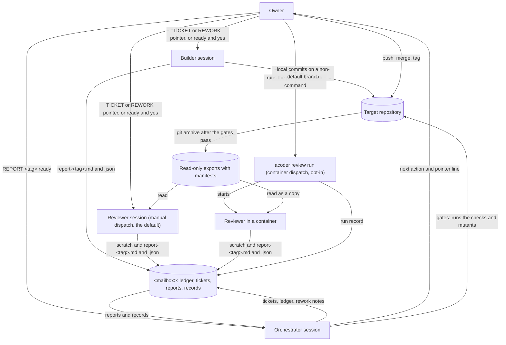
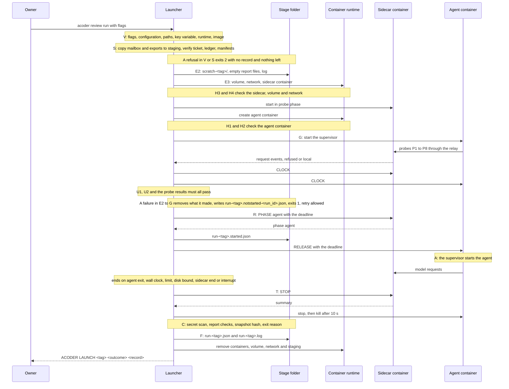
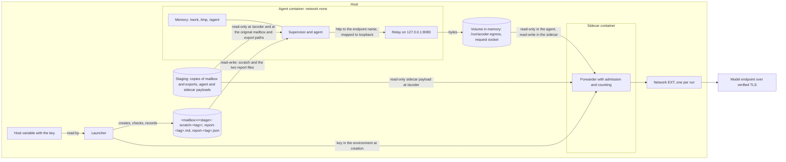
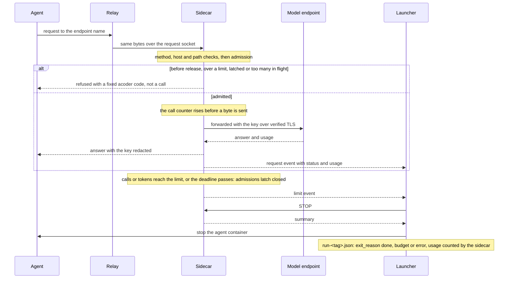

# Architecture

## Roles and handoffs

The owner carries every handoff between three sessions through a mailbox outside the
repository; a reviewer ticket can instead run in a container that the owner launches.

## Launch sequence

One `acoder review run` goes through the states validate (V), snapshot (S), mailbox
effects (E2), runtime resources (E3), gate (G), release (R), agent (A), stop (T),
scan and evaluate (C) and finalize (F).

## Topology and mounts

The agent container has no network; its only way out is a request socket on a
memory-backed volume shared with the sidecar, which alone holds the key and alone is
attached to a network.

## Egress path and budgets

The sidecar admits, counts and refuses every model request; the launcher stops the
run with STOP before it signals the agent and records why the run ended.

